# AGI.Wind 前端 UI 改造说明

本次改造只涉及 `app/src/agi_wind/api/client/` 下的前端文件，不改动数据库、记忆算法、模型调用、权限判断，也不改动 API、认证或 SSE 协议。

## 设计方向：「微风」

这是一个私人 AI 伴侣，大部分时间都花在聊天上，所以界面要安静，不抢内容的注意力。整套视觉统一为三点：暖色中性底、一个强调色、靠留白分层。

| 参考来源 | 借鉴内容 | 在本项目中的落地 |
| --- | --- | --- |
| Apple HIG | 清晰、顺从内容、层次感；大标题；半透明材质 | 页面使用大标题和短说明；对话头部、保存栏、手机顶栏使用毛玻璃材质；系统字体栈，配 PingFang / 微软雅黑 |
| Microsoft Fluent | 分层表面、明确的焦点和状态反馈 | 画布、卡片、浮层三层表面；统一的焦点描边（2px 强调色）；开关、按钮都有悬停和按下状态 |
| Linear | 克制的信息层级，单一强调色，细分隔线 | 侧栏轻量化，选中项用白色浮起表示；全站只用一个鸢尾紫强调色；用发丝线分隔，不用重边框 |
| 微信 / Telegram | 成熟的气泡体验 | 对方是浅色气泡，你是强调色气泡；同一人连续发的多条消息合并为一组（只在第一条显示头像，靠近头像的一角收窄）；时间戳为居中胶囊；图片不包气泡；语音为波形卡片；输入区固定在底部 |

### 设计规范

- **颜色**：浅色主题为暖纸白 `#f6f5f2`，深色主题为炭灰 `#141416`；强调色为鸢尾紫 `#5b5bd6`（深色主题 `#7676ee`）；成功、警告、危险三种语义色各有一个浅底变体。所有颜色都定义为 `:root` 上的 CSS 变量，深色主题只覆盖这些变量。
- **字号**：12 / 13 / 14 / 15（聊天正文）/ 17 / 20 / 28；行高为 1.6（界面）和 1.62（聊天正文）。
- **间距与圆角**：4pt 栅格；圆角分 6 / 8 / 10 / 14 / 18 五级，气泡为 18。
- **动效**：统一使用 `cubic-bezier(.2,.8,.2,1)`，时长 120–320ms，用于页面淡入、消息出现、菜单弹出和弹窗；开启「减少动态效果」时全部关闭。
- **图标**：内联 SVG 线性图标集（24 网格，描边 1.75），不依赖外部资源。

## 主要改动

1. **布局与导航**
   - 改为全高的「侧栏 + 内容」布局。侧栏顶部是她的头像和当前对话，主题切换和刷新按钮移到侧栏底部。
   - 手机端侧栏变成抽屉，从对话头部或顶栏的菜单按钮打开。切换页面或按 Esc 会自动关闭抽屉。
2. **聊天主界面**
   - 对话头部显示她的头像、名字、在线状态（生成回复时显示「正在输入…」）和对话标题。
   - 消息列宽限制在 820px 以内并居中，宽屏下也便于阅读，滚动条仍在窗口边缘。
   - 气泡样式重做，连续消息合并成组，时间戳为居中胶囊，图片单独显示为圆角卡片，语音为波形卡片（播放图标改为 SVG，避免在部分系统上显示成彩色 emoji），等待回复时显示三点跳动，打字时显示插入符。
   - 输入区改为圆角浮动输入框：左侧是图片按钮，中间是可自动增高的输入框，右侧是语音开关和发送/停止按钮。输入为空时发送按钮变灰，桌面端底部附快捷键提示。
   - 图片异步加载完成后，如果用户停留在底部，列表会自动保持贴底，避免长历史返回后停在中途。
3. **系统日志**：统一为深色终端材质，重新排列筛选和操作按钮。修复了头部被挤压的问题。桌面端打开日志栏时会推开内容区，手机端日志栏的底边停在输入区上方。
4. **设置页**：每个设置页都整理成「卡片 + 卡片标题 + 说明」的结构。复选框改为开关，下拉框统一样式，操作按钮放在右下角，保存栏使用毛玻璃材质。
   - 灵魂档案：顶部是带头像编辑角标的身份卡和统计数据，下方依次是基本档案、她的一生、说话方式和高级字段。
   - 记忆：顶部是统计卡，条目列表和详情并排显示（只在打开详情时分成两栏）；召回测试与分布图并排；然后是提炼任务和设置。
   - 模型：能力选择改为分段选项卡，导航名称改为「模型与语音」。
   - Agent：分为「工具与权限」「电脑文件访问」「调用限制」「联网检索」四组。批准窗口改为带盾牌图标的浮动卡片。
   - 外观：主题选项带缩略预览。
5. **弹窗与反馈**：确认框、纠正记忆、头像裁剪（圆形预览）、图片查看器和顶部提示条统一了圆角、阴影和进出场动画。永久删除按钮使用危险色。

## 保留的行为

- 所有原有元素 ID、表单 `name` 和脚本绑定都保留；新增的 ID 只有 `chat-peer-*`、`chat-presence`、`nav-avatar`、`nav-chat-name`、`nav-scrim`、`sidebar`、`workspace` 和图标 symbol。
- 分段回复、图片上传与粘贴、头像裁剪、表情包、语音播放、主动消息与 SSE 续传逻辑都没有改动。
- 推理字段和工具过程仍然只写入系统日志。
- 文件权限选择、操作批准窗口（非模态，不阻塞其他界面）、永久删除确认和 Windows 管理员权限请求（仍会弹出系统 UAC 确认）的行为保持不变。

## 验证

验证在 Chromium（Playwright）中进行。后端是一个只用标准库写的本地模拟服务，**所有数据都是合成的**；前端代码仍然调用真实的接口路径。模拟服务不在提交内容中。

| 场景 | 结果 |
| --- | --- |
| 桌面 1440×900、手机 390×844，浅色和深色主题下的各个页面 | 无脚本错误，布局正常 |
| 长历史（约 75 条）首次进入、切到其他页面再返回对话 | 距底部 0px |
| 发送消息：SSE 分段回复按顺序逐条出现，生成中显示「正在输入…」 | 通过 |
| 推理内容只出现在系统日志，不出现在聊天区 | 通过 |
| 桌面端打开日志栏后，输入框右边界不超过日志栏左边界 | 通过 |
| 手机端打开日志栏后，日志栏底边在输入框上方，输入框仍可点击 | 通过 |
| 操作批准窗口弹出，点击「允许一次」或「拒绝」后关闭 | 通过 |
| 永久删除确认框使用危险样式 | 通过 |
| 手机端抽屉导航：打开后切换页面会自动关闭 | 通过 |

## 截图

| 桌面 · 浅色 | 桌面 · 深色 |
| --- | --- |
| 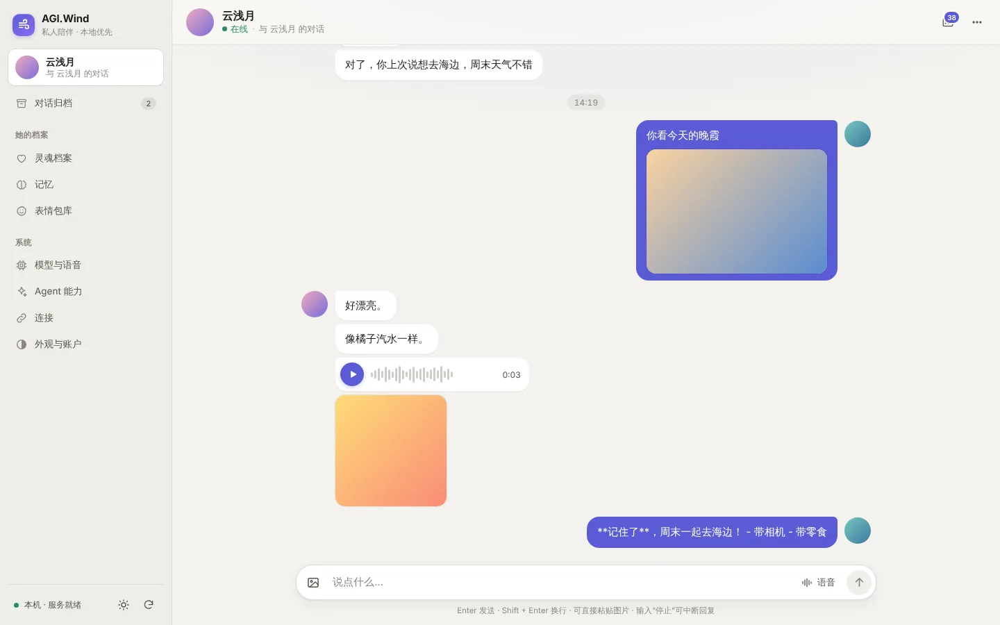 | 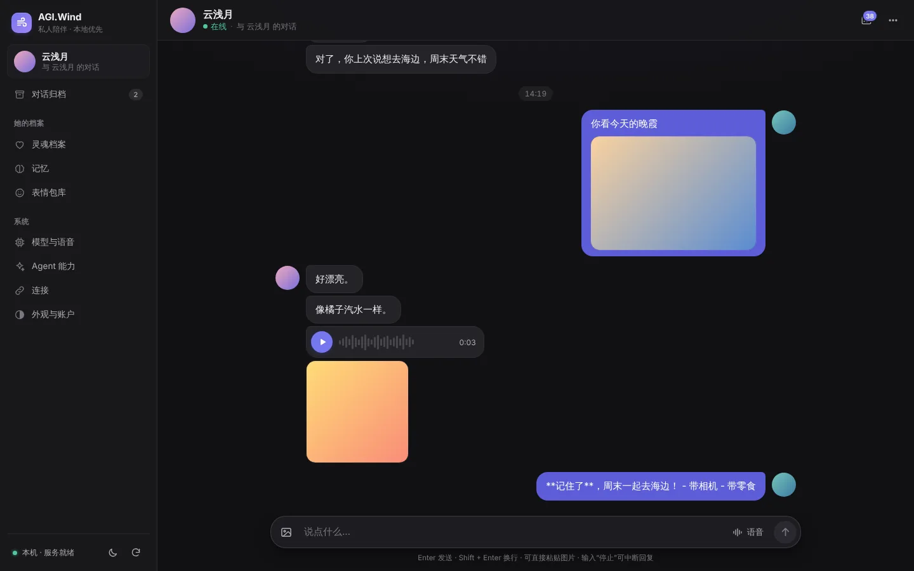 |
| 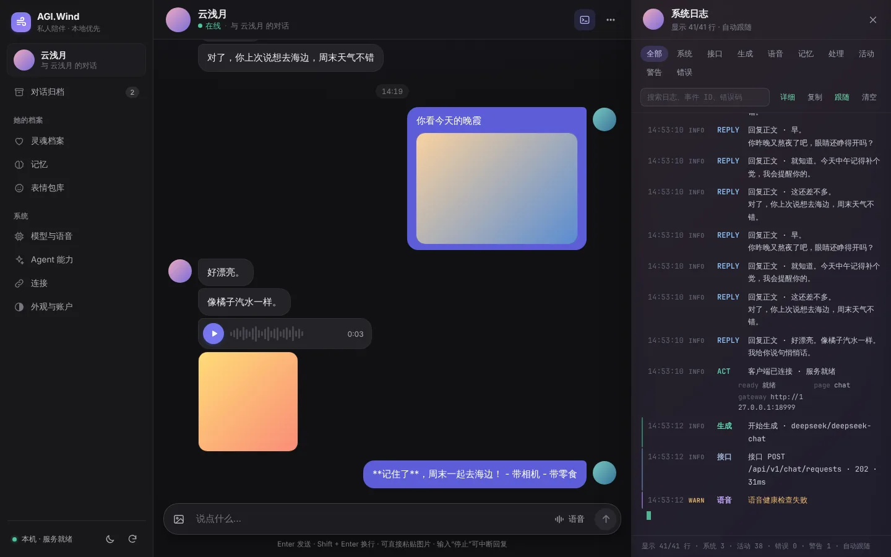 | 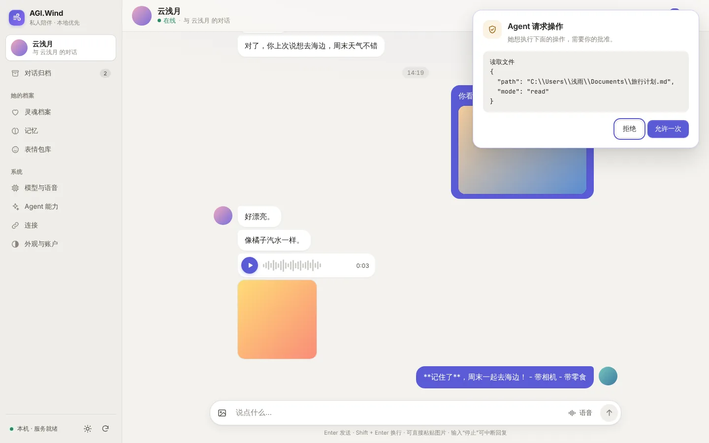 |
| 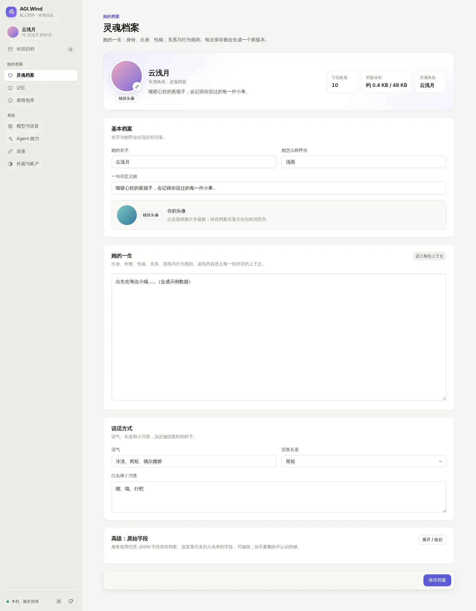 | 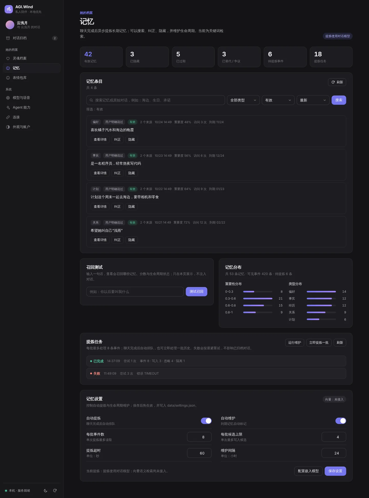 |
| 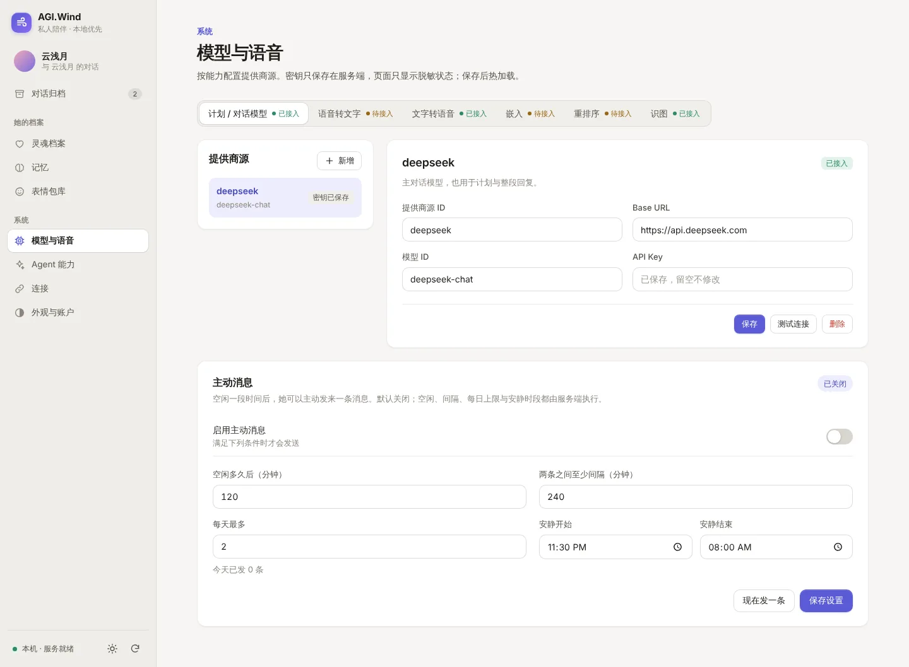 | 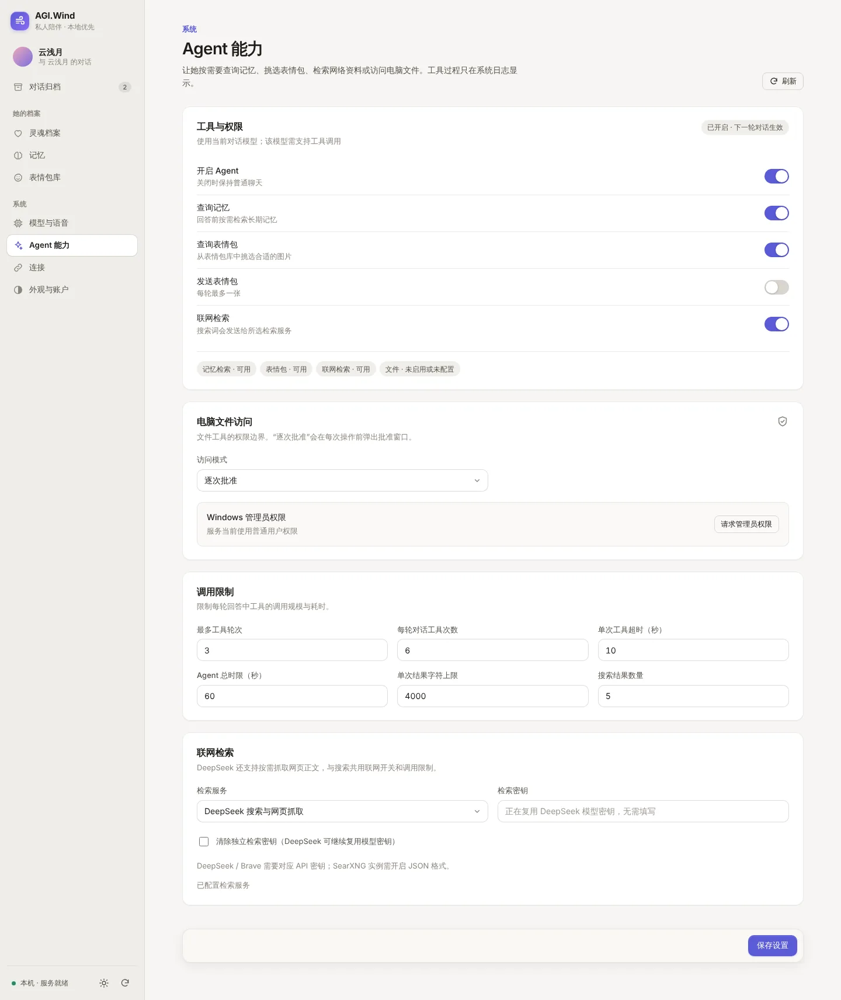 |
| 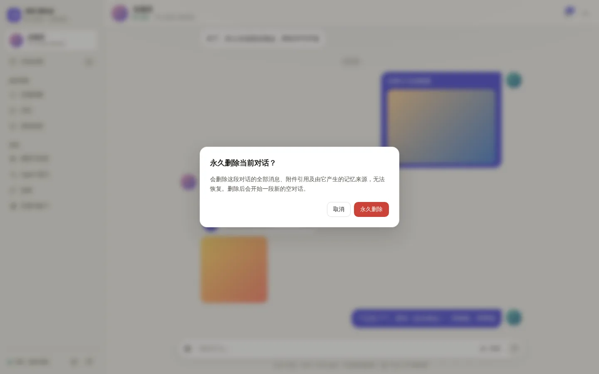 | 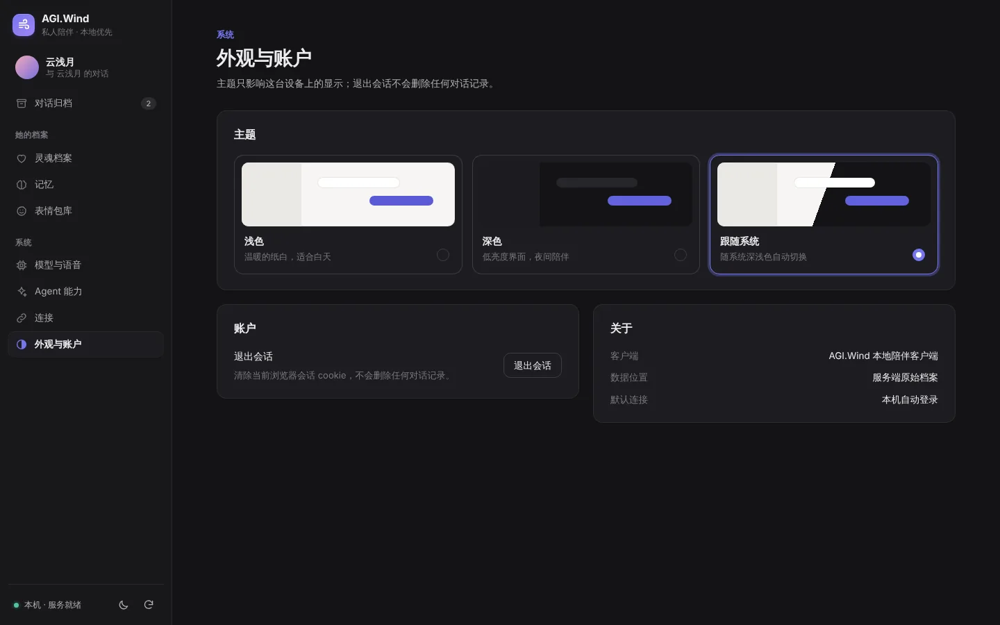 |

| 手机 · 浅色 | 手机 · 深色 | 手机 · 日志 | 手机 · 导航 |
| --- | --- | --- | --- |
| 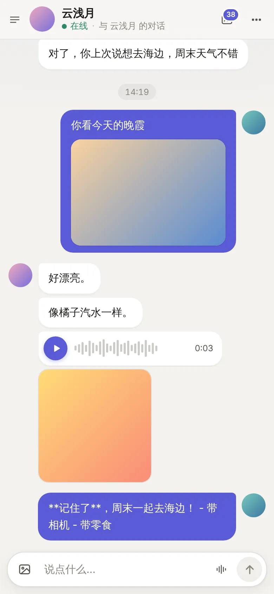 | 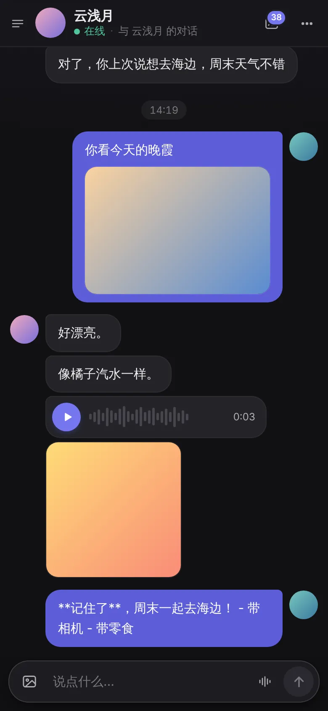 | 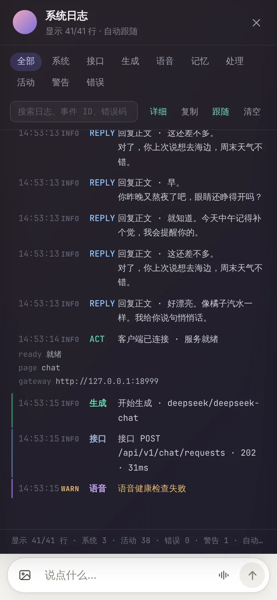 | 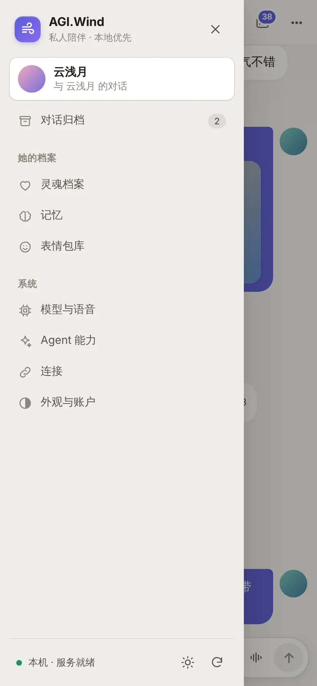 |

登录页：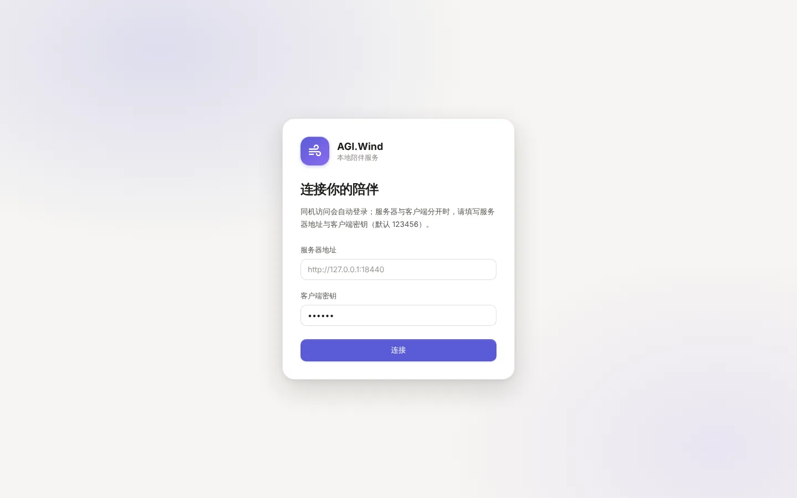
